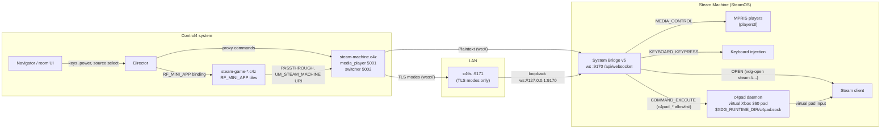
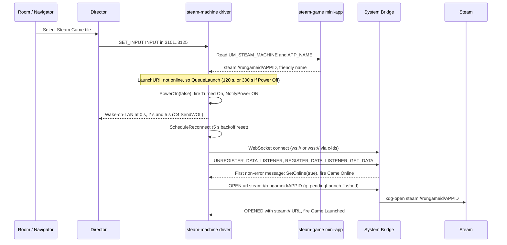
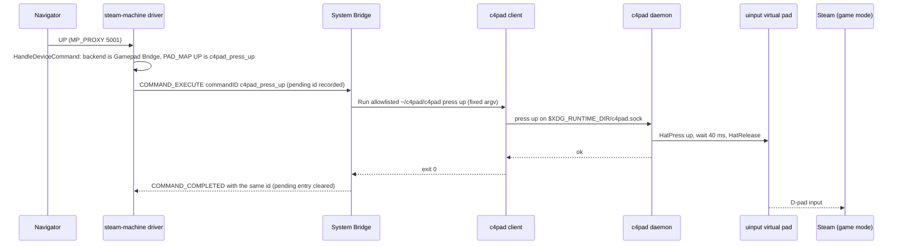

# Architecture

This document describes how the pieces of the Control4 Steam Machine driver suite
fit together, how they talk to each other, and how the main driver is organized
internally. It is written for developers and integrators. For installation steps see
[INSTALLATION.md](INSTALLATION.md); for the threat model see [../SECURITY.md](../SECURITY.md).

## Components

| Component | Where | Runs on | Role |
|---|---|---|---|
| Steam Machine driver | `steam-machine/` (`steam-machine.c4z`) | Control4 Director | Media_player proxy, HDMI/audio connections, WebSocket client to System Bridge, programming events and variables, hosts up to 25 game mini-apps |
| Steam Game mini-app | `steam-game-miniapp/` (`steam-game-miniapp.c4z`, per-game `steam-game-<appid>.c4z`) | Control4 Director | One Watch-list tile per game; publishes the game's `steam://` URI to the parent |
| System Bridge v5 | third-party, installed on the Steam Machine | SteamOS / Linux | Token-authenticated WebSocket API (port 9170) that runs OPEN, media, keyboard, power and allowlisted commands |
| c4pad | `steamos-pad/` | Steam Machine, user systemd unit | Persistent virtual Xbox 360 pad (`/dev/uinput`) so navigator keys work in game mode. Owner-only Unix socket, no network listener |
| c4tls | `steamos-tls/` | Steam Machine, user systemd unit | Optional TLS terminator: `wss://` on the LAN to loopback `ws://` for System Bridge |
| Vendored libraries | `steam-machine/drivers-common-public/` | Inside the driver `.c4z` | Snap One `drivers-common-public` WebSocket, handler, timer and JSON modules; see [PROVENANCE.md](../steam-machine/drivers-common-public/PROVENANCE.md) |
| Build tools | `tools/*.ps1` | Developer Windows PC | Package `.c4z` files, cross-compile the Go helpers, generate game mini-drivers and release bundles |

## Component diagram



## Trust boundaries and transport

- **System Bridge** serves `ws://<ip>:9170/api/websocket` only. Every message is a JSON
  object carrying the token (see [Protocol](#system-bridge-protocol)). The token is a
  full local-user credential, so the default plaintext transport is a LAN-only risk
  that [SECURITY.md](../SECURITY.md) describes in detail.
- **Connection Security** (driver property) selects the transport:
  - `Plaintext (ws://)`: direct to System Bridge on port 9170 (default).
  - `TLS encrypt-only (wss://)`: `wss://<ip>:9171` to c4tls, `VERIFY_MODE = 'none'`.
  - `TLS pinned (wss://)`: same URL, `VERIFY_MODE = 'peer'` and `CACERTFILE = './c4tls_ca.pem'`.
    If no certificate has been pasted, the driver falls back to encrypt-only and records
    the downgrade in `g_effectiveVerify = 'none-fallback'`.
- **c4tls** listens on `:9171` (LAN side) and splices each TLS connection to
  `127.0.0.1:9170` (`-listen`, `-backend` flags in `steamos-tls/main.go`). The token is
  only in cleartext on the Steam Machine's loopback interface when TLS is used.
- **c4pad** has no network listener. It only accepts commands on `$XDG_RUNTIME_DIR/c4pad.sock`
  (owner-only, `0600`). The driver never talks to it directly; System Bridge runs the
  `~/c4pad/c4pad` client as an allowlisted `COMMAND_EXECUTE` command.

## SteamOS side

| Driver action | System Bridge event | What runs on SteamOS |
|---|---|---|
| Open a `steam://` URI, Big Picture, library, settings | `OPEN` with `{ url }` | `xdg-open` on the URI (SECURITY.md). Only `steam://` is allowed past the driver |
| Transport keys (Play, Pause, Skip, Scan) | `MEDIA_CONTROL` with `PLAY`, `PAUSE`, `NEXT`, `PREVIOUS`, `STOP`, `VOLUME_UP`, `VOLUME_DOWN`, `MUTE` | playerctl against MPRIS players (browser, Spotify). Not the game audio |
| Nav keys in Keyboard backend | `KEYBOARD_KEYPRESS` with `{ key, delay = 0 }` | Keyboard injection. Works on the Desktop, not reliably in the gamescope game session |
| Nav keys and Steam chords in Gamepad Bridge backend | `COMMAND_EXECUTE` with `{ commandID = "c4pad_..." }` | `~/c4pad/c4pad <action> <button>` or `chord`, which talks to the c4pad daemon socket |
| Power | `POWER_SLEEP`, `POWER_SHUTDOWN`, `POWER_RESTART`, `POWER_LOCK` | Power actions performed by System Bridge. The driver does not implement them |
| Notifications | `NOTIFICATION` with `{ title, message }` | Desktop notification |
| Data | `REGISTER_DATA_LISTENER` and `GET_DATA` for `system`, `cpu`, `memory`, `gpus`, `media`, `battery` | Pushed back as `DATA_UPDATE` messages |

Wake-on-LAN is not a System Bridge call. The driver sends it with `C4:SendWOL(g_mac)`
straight from Control4.

## Sequence diagrams

### (a) Launching a game from a mini-app tile while the machine is asleep

The launch is queued, the machine is woken with Wake-on-LAN, and the `steam://` URI is
sent once System Bridge answers.



### (b) Navigator D-pad press in game mode through c4pad

With `Nav Input Backend` set to `Gamepad Bridge`, the D-pad press becomes an allowlisted
`COMMAND_EXECUTE` that runs the c4pad client, which talks to the daemon over its socket.



A hold (`START_UP`) uses `c4pad_hold_up`. The driver re-sends it every 2 s, and the daemon
releases it after 5 s if nothing refreshes it.

## Driver internals (steam-machine/driver.lua)

The driver is one Lua file (`steam-machine/driver.lua`) that loads the vendored
libraries with:

```lua
require ('drivers-common-public.global.handlers')
require ('drivers-common-public.global.timer')
WebSocket = require ('drivers-common-public.module.websocket')
```

The Snap One `handlers.lua` provides the Control4 entry points. The driver's own
functions are dispatched through tables:

| Control4 callback (handlers.lua) | Dispatches to |
|---|---|
| `OnPropertyChanged(strProperty)` | `OPC[name]`, where spaces in the property name become `_` (for example `OPC.System_Bridge_Token`) |
| `ExecuteCommand(strCommand, tParams)` | `EC[name]`, where spaces become `_` (for example `EC.Get_MAC_Address`, `EC['Toggle_On-Screen_Keyboard']`) |
| `ReceivedFromProxy(idBinding, strCommand, tParams)` | `RFP[strCommand]`, then `RFP[idBinding]`. `PASSTHROUGH` is unwrapped by the driver |
| `ReceivedFromNetwork(idBinding, nPort, strData)` | The vendored `WebSocket` module, which calls the callbacks set in `Connect` |

### Lifecycle

1. **`OnDriverInit`** creates the 12 variables (`ONLINE`, `UPTIME_SECONDS`, `UPTIME_TEXT`,
   `HOSTNAME`, `CPU_TEMPERATURE`, `GPU_TEMPERATURE`, `CPU_USAGE`, `MEMORY_USED_PERCENT`,
   `BATTERY_PERCENT`, `NOW_PLAYING`, `MEDIA_STATUS`, `CURRENT_GAME`) in a fixed order, then
   loads the token from encrypted PersistData into `g_token`.
2. **`OnDriverLateInit`** replays `OnPropertyChanged` for every property (this is where
   `OPC.Connection_Security`, `OPC.Debug_Mode` and the rest first run), sets the read-only
   status properties (`Driver Version`, `Director Connection`, `Token Status`), hides the
   switcher proxy (`HideProxyInAllRooms(SWITCHER_PROXY)`), calls `RefreshAddress()`, and
   starts the `StaleCheck` timer (60 s, repeating).
3. **`OnNetworkBindingChanged(6001)`** calls `RefreshAddress()` when the IP changes.
4. **`OnDriverDestroyed`** deletes the WebSocket and kills all timers.

### Properties (OPC handlers)

| Property | Handler | Effect |
|---|---|---|
| `Debug Mode` | `OPC.Debug_Mode` | Sets `DEBUGPRINT`. Forces `DEBUG_WEBSOCKET = false`, because frames contain the token |
| `System Bridge Token` | `OPC.System_Bridge_Token` | Stores the token in PersistData, clears the property, and re-subscribes if connected |
| `Connection Security` | `OPC.Connection_Security` | Sets `g_secMode`, then `Reconnect()` |
| `TLS Port` | `OPC.TLS_Port` | Sets `g_tlsPort` (default `SB_TLS_PORT = 9171`), reconnects in TLS modes |
| `Server Certificate` | `OPC.Server_Certificate` | Accepts raw PEM or base64 PEM, writes `c4tls_ca.pem` with `FileWrite`, sets `g_caReady` |
| `MAC Address` | `OPC.MAC_Address` | Normalizes to `AA:BB:CC:DD:EE:FF` into `g_mac`, or clears a malformed value |

Other properties are read when needed rather than through a handler:
`Launch Into Big Picture`, `Off Mode`, `Nav Input Backend`, and the four
`<Color> Button Action` properties.

### Connection management

- **`RefreshAddress()`** reads `C4:GetBindingAddress(NET_BINDING)`. On a change it
  deletes the old socket, calls `SetOnline(false)`, and calls `Connect()`.
- **`ConnectionConfig()`** builds the URL and TLS options for the current mode, as above.
- **`Connect()`** creates `WebSocket:new(url, nil, wssOptions)` once and registers four
  callbacks: `SetEstablishedFunction` (`OnWsEstablished`), `SetProcessMessageFunction`
  (`OnWsMessage`), `SetOfflineFunction` and `SetClosedByRemoteFunction` (both `OnWsDown`).
  It then calls `g_ws:Start()`.
- **`Reconnect()`** tears the socket down and calls `Connect()`. Used after security,
  port or certificate changes.
- **`OnWsEstablished()`** marks TCP as up, resets the backoff, and reports the active
  mode (plaintext, TLS encrypt-only, TLS pinned, or the pinned-fallback warning). It then
  calls `SBSubscribe()`.
- **`OnWsDown(reason)`** clears the pending pad state, calls `SetOnline(false)`, and
  calls `ScheduleReconnect()`.
- **`ScheduleReconnect()`** uses the `Reconnect` timer. Each attempt doubles
  `g_reconnectDelay` from 5 s up to 60 s.
- **`CheckStale()`** runs from `StaleCheck`. If no message has arrived for
  `STALE_SECONDS` (180 s) it restarts the socket. It also drops pad requests older than 60 s.
- **`SetOnline(online)`** is the only place that changes `g_online`. It sets `ONLINE`,
  updates `System Bridge Connection`, fires `Came Online` or `Went Offline`, and flushes
  `g_pendingLaunch` with `SBOpen`. It does not send power notifications. The source
  comment explains that doing so would select sources in rooms on every socket blip.

### System Bridge protocol

`SBSend(event, data)` builds the message and sends it with `g_ws:Send`:

```lua
msg = { id = 'c4-' .. g_msgId .. '-' .. event, event = event, data = data or {}, token = g_token }
```

It returns the message id, or `false` when the socket is not running or no token is set.

Helpers built on `SBSend`:

| Function | Event | Notes |
|---|---|---|
| `SBSubscribe()` | `UNREGISTER_DATA_LISTENER`, `REGISTER_DATA_LISTENER`, `GET_DATA` | Modules: `system`, `cpu`, `memory`, `gpus`, `media`, `battery` (`SB_MODULES`). Listeners are dropped by the server on disconnect, so this runs on every connect |
| `SBOpen(uri)` | `OPEN` `{ url }` | |
| `SBMedia(action)` | `MEDIA_CONTROL` `{ action }` | |
| `SBKey(key)` | `KEYBOARD_KEYPRESS` `{ key, delay = 0 }` | Accepts at most 24 characters from `^[%w_%.%+%*/%-]+$`, otherwise logs and drops |
| `PadCmd(commandID)` | `COMMAND_EXECUTE` `{ commandID }` | Records the id in `g_pendingPad` for the missing-command fallback |

Inbound messages go through **`OnWsMessage(data)`**:

- Undecodable JSON is logged and dropped.
- `ERROR` with `BAD_TOKEN` or `MISSING_TOKEN` sets `System Bridge Connection` to the
  token message. `ERROR` with `COMMAND_NOT_FOUND` for a pending pad id calls
  `OnPadCommandMissing`. Other errors are logged.
- Any other message calls `SetOnline(true)`, which is how the driver knows the token works.
- `DATA_UPDATE` calls `HandleModule(msg.module, msg.data)`.
- `OPENED` with a `steam://` URL fires `Game Launched`.
- `NOTIFICATION_SENT` fires `Notification Sent`.
- `COMMAND_COMPLETED` clears the pending pad entry and logs a non-zero `exitCode`.

**`HandleModule(module, data)`** maps the data to variables and events:

- `system`: `UPTIME_SECONDS`, `UPTIME_TEXT`, `HOSTNAME` (sanitized), and the MAC address
  when a fetch was requested or the property is empty.
- `cpu`: `CPU_TEMPERATURE`, `CPU_USAGE`. `gpus`: `GPU_TEMPERATURE` (the highest reading).
  `memory`: `MEMORY_USED_PERCENT`. `battery`: `BATTERY_PERCENT`.
- `media`: `NOW_PLAYING` (`title - artist`). When `status` changes it sets `MEDIA_STATUS`,
  fires `Media Started Playing`, `Media Paused` or `Media Stopped`, and sends `PLAY`,
  `PAUSE` or `STOP` to the media_player proxy with `NOTIFY`.

Inbound strings are passed through `safeStr()`, which strips control characters and caps
the length at `MAX_VAR_LEN` (256).

### Power and launching

- **`PowerOn(allowBigPicture)`** fires `Turned On`, sends `NotifyPower('ON')`, and, when a MAC
  address is set, sends Wake-on-LAN at 0 s, 2 s and 5 s (`C4:SendWOL`, with timers `WOL2` and `WOL3`). If the
  socket is down it resets the backoff and schedules a reconnect. If
  `allowBigPicture` is set, `Launch Into Big Picture` is On, and no game was launched in
  the last `LAUNCH_GRACE_SECONDS` (15 s), it opens Big Picture now or queues it.
- **`PowerOff(immediate)`** fires `Turned Off`, sends `NotifyPower('OFF')`, and clears any
  pending launch. Unless `immediate` is set it waits 5 s (`DeferredOff`) so a source
  switch between mini-apps does not suspend the PC. `Off Mode` picks `POWER_SLEEP`,
  `POWER_SHUTDOWN`, or nothing.
- **`QueueLaunch(uri)`** stores `g_pendingLaunch` with a 120 s expiry, or 300 s when
  `Off Mode` is `Power Off` (cold boot). The expiry timer is `PendingLaunch`.
- **`LaunchURI(uri, friendlyName)`** is the single gate for every launch. It rejects any
  scheme not in `ALLOWED_URI_SCHEMES` (only `steam`). For `steam://` it records
  `g_lastGameLaunch` and sets `CURRENT_GAME`. If online it calls `SBOpen`, otherwise
  `QueueLaunch(uri)` followed by `PowerOn(false)`.

### Proxy commands (RFP)

The driver has two proxy bindings:

- `RFP[MP_PROXY]` (5001, media_player): calls `HandleDeviceCommand(strCommand, tParams)`.
  `PASSTHROUGH` is unwrapped first, so commands sent by a mini-app arrive here too.
- `RFP[SWITCHER_PROXY]` (5002, avswitch): handles `PASSTHROUGH` the same way, `SET_INPUT`
  (see the mini-app contract below), and ignores `ON` and `OFF`.

`HandleDeviceCommand` dispatches in this order:

1. `ON` → `PowerOn(true)`. `OFF` → `PowerOff()`.
2. `MEDIA_MAP` (transport) → `SBMedia`. Maps `PLAY`, `PAUSE`, `STOP`, `SKIP_FWD` and
   `SCAN_FWD` to `NEXT`, `SKIP_REV` and `SCAN_REV` to `PREVIOUS`.
3. If `Nav Input Backend` is `Gamepad Bridge` and the command is in `PAD_MAP` → `SBPad`.
4. `KEY_MAP` (D-pad, Enter, Back, Page Up/Down) → `SBKey`.
5. `URI_CMD_MAP` (`MENU`, `HOME` → Big Picture; `GUIDE` → library; `SETTINGS`) → `LaunchURI`.
6. `STOP_*` releases are ignored on the keyboard path.

In the Gamepad Bridge backend, `SBPad(strCommand)` maps the command through `PAD_MAP` to
a c4pad allowlist ID such as `c4pad_press_up`. Holds (`START_*`) also start
`PadHoldRefresh`, which re-sends the hold every 2 s, because the daemon releases any hold
after 5 s. `STOP_*` releases cancel the refresh and send one echo release after 200 ms,
because `COMMAND_EXECUTE` is asynchronous.
`OnPadCommandMissing` handles `COMMAND_NOT_FOUND` by degrading a hold to a press
(`PAD_FALLBACK`) or falling back to the keyboard path.

### Mini-app switching (SET_INPUT)

`RFP[SWITCHER_PROXY]` receives `SET_INPUT` with `INPUT`. If `INPUT` is in
`MINIAPP_BINDING_START` (3101) to `MINIAPP_BINDING_END` (3125), it calls
`LaunchMiniApp(idBinding, input)`:

1. `C4:GetBoundConsumerDevices` finds the device consuming the switcher's binding (`idBinding`). `C4:GetBoundProviderDevice` then finds the mini-app proxy bound to `input` on it. The code then looks for the device bound to that proxy's binding 5001 (the mini's media_player proxy) and uses the proxy itself if nothing is bound there.
2. Read the mini-app's `UM_STEAM_MACHINE` device variable (`GetUniversalAppId`). If it is
   empty, fall back to `APP_ID`.
3. Read `APP_NAME` as the friendly name, then call `LaunchURI(uri, appName)`.

### Steam UI actions and colored buttons

Each navigator colored button runs the `EC` command of the same name, which calls
`RunButtonAction(color)`:

```text
EC.Red_Button / Green_Button / Yellow_Button / Blue_Button
  -> RunButtonAction(color)
     Properties[color .. ' Button Action']
       'None'                        -> nothing
       'Fire Programming Event'      -> C4:FireEvent(color .. ' Button Pressed')
       anything else                 -> SteamAction(name)
```

`SteamAction(name)` looks up `STEAM_ACTIONS`:

| Action (property value) | Implementation |
|---|---|
| Steam Menu | `PadCmd('c4pad_steam')` |
| Quick Access Menu | `PadCmd('c4pad_qam')` |
| Toggle On-Screen Keyboard | `PadCmd('c4pad_osk')` |
| Screenshot | `PadCmd('c4pad_screenshot')` |
| Toggle Magnifier | `PadCmd('c4pad_magnifier')` |
| Force Quit Game | `PadCmd('c4pad_forcequit')` |
| Launch Big Picture | `LaunchURI(URI_BIG_PICTURE)` |
| Media Play/Pause | `SBMedia('PLAY')` |

The `c4pad_*` IDs are created by `steamos-pad/install.sh` as `chord` commands. They need the
Gamepad Bridge installed; the Big Picture and media actions do not.

### Programming and Composer commands (EC)

| Composer action or command | EC handler | Calls |
|---|---|---|
| Get MAC Address From Steam Machine | `EC.Get_MAC_Address` | `GET_DATA` for `system`, sets `g_wantMacUpdate` |
| Clear Stored Token | `EC.Clear_Stored_Token` | Blanks the PersistData key |
| Test Connection | `EC.Test_Connection` | `g_ws:Start()` if a socket exists, otherwise `RefreshAddress()` |
| Send Test Notification | `EC.Send_Test_Notification` | `NOTIFICATION` |
| Launch Big Picture (Now) | `EC.Launch_Big_Picture` | `LaunchURI` |
| Power On / Power Off | `EC.Power_On` / `EC.Power_Off` | `PowerOn(true)` / `PowerOff(true)` |
| Sleep, Shut Down, Restart, Lock | `EC.Sleep`, `EC.Shut_Down`, `EC.Restart`, `EC.Lock` | `POWER_*` |
| Launch Steam Game | `EC.Launch_Steam_Game` | Numeric ID → `steam://rungameid/<id>`, else a `steam://` URI |
| Open URI | `EC.Open_URI` | `LaunchURI` |
| Send Notification | `EC.Send_Notification` | `NOTIFICATION` |
| Media Play Pause / Next / Previous / Stop | `EC.Media_*` | `SBMedia` |
| Media Volume Up / Down / Mute | `EC.Media_Volume_Up`, `EC.Media_Volume_Down`, `EC.Media_Mute` | `SBMedia` `VOLUME_UP`, `VOLUME_DOWN`, `MUTE` |
| Send Keyboard Key | `EC.Send_Keyboard_Key` | `SBKey` |
| Press Gamepad Button | `EC.Press_Gamepad_Button` | `PadCmd('c4pad_press_<token>')` |
| Red / Green / Yellow / Blue Button | `EC.Red_Button` and the others | `RunButtonAction` |
| Steam Menu, Quick Access Menu, Toggle On-Screen Keyboard, Screenshot, Toggle Magnifier, Force Quit Game | `EC.Steam_Menu`, `EC.Quick_Access_Menu`, `EC['Toggle_On-Screen_Keyboard']`, `EC.Screenshot`, `EC.Toggle_Magnifier`, `EC.Force_Quit_Game` | `SteamAction` |

Every outbound `steam://` launch goes through `LaunchURI`, and every `OPEN` goes through
`SBOpen`, which is called only from `LaunchURI`, `SetOnline` and `PowerOn`.

## State

| State | Where it lives | Survives restart? |
|---|---|---|
| Token | Director encrypted PersistData, key `sb_token` (`C4:PersistSetValue(..., true)`) | Yes, encrypted. The `System Bridge Token` property is blanked after save |
| MAC address | `MAC Address` property (`g_mac` mirrors it) | Yes, as a project property |
| Connection Security, TLS Port, Server Certificate | Properties, then `g_secMode`, `g_tlsPort`, `g_caReady` | Properties yes; globals are rebuilt on init |
| Pinned certificate | File `c4tls_ca.pem` in the driver sandbox (`FileWrite`) | Yes |
| Variables (`ONLINE`, `NOW_PLAYING`, `HOSTNAME`, `CURRENT_GAME`, ...) | Control4 variables | Yes, in the Director DB and project backups (see SECURITY.md) |
| Socket, pending requests, timers, holds | Globals: `g_ws`, `g_pendingLaunch`, `g_pendingPad`, `g_activeHolds`, `g_lastRx`, and so on | No |

Timer ids used by the driver: `StaleCheck`, `Reconnect`, `WOL2`, `WOL3`, `DeferredOff`,
`PendingLaunch`, `PadHoldRefresh`, and `PadEchoRelease_<direction>`.

## Mini-app contract (steam-game-miniapp)

A mini-app is a Universal Minidriver-style device. It follows the Control4 `um_netflix` and
`roku` pattern.

- **Properties**: `Game Name`, `Steam App ID or URI`, and the read-only `Launch URI`.
  `UpdateAppData()` accepts a numeric App ID and turns it into `steam://rungameid/<id>`. It
  also accepts a `steam://` URI that matches a conservative character set. Anything else
  sets `Launch URI` to a rejection message and publishes an empty URI.
- **Published variables** (created in `OnDriverInit`):
  - `APP_NAME`: the game name, defaulting to `Steam Game`, control characters replaced,
    capped at 128 characters.
  - `UM_STEAM_MACHINE`: the `steam://` URI that the parent launches. Its name is held in
    the mini's `MINIAPP_TYPE` constant.
- **Bindings**: the mini has a `MEDIA_PLAYER` proxy (5001) and an `RF_MINI_APP` connection
  (3101). The parent's switcher proxy (5002) hosts `RF_MINI_APP` consumer bindings 3101 to
  3125. A room selects a tile with `SET_INPUT` on that input.
- **Room tracking**: the mini registers for `CURRENT_SELECTED_DEVICE` (1000) and
  `CURRENT_AUDIO_PATH` (1007) on each room, using `OnPIP` to refresh. It works out which
  parent device the room's audio path routes to (`RoomIDTargets`).
- **Command forwarding**: the mini's own `ReceivedFromProxy` sets `PASSTHROUGH_COMMAND` to
  the room's command and sends `PASSTHROUGH` to the parent with `SendToDevice`. The
  parent unwraps it in `RFP[MP_PROXY]` or `RFP[SWITCHER_PROXY]`.

Because the parent launches the URI, the mini does not need its own socket and holds no
token.

## Vendored libraries

The files under `steam-machine/drivers-common-public/` are unmodified copies of the Snap One
`control4/drivers-common-public` repository. The driver loads three of them:

| File | Role | Version constant |
|---|---|---|
| `global/handlers.lua` | Dispatch for `OnPropertyChanged`, `ExecuteCommand`, `ReceivedFromProxy`, `ReceivedFromNetwork`, `UpdateProperty`, `SetVariable` | `COMMON_HANDLERS_VER = 17` |
| `global/timer.lua` | `SetTimer`, `CancelTimer`, `KillAllTimers`, `ONE_SECOND` | `COMMON_TIMER_VER = 10` |
| `module/websocket.lua` | `WebSocket:new`, `Start`, `Send`, `delete`, and the callbacks | `COMMON_WEBSOCKET_VER = 7` |

The other vendored files are `global/lib.lua` (`dbg`, `JSON`, and helpers), `module/json.lua`
(Jeffrey Friedl's JSON module), and `module/metrics.lua`. The driver also sets
`DEBUG_WEBSOCKET = false` so the library never logs frames, because frames contain the token.

## Packaging

`tools/build.ps1` packages each folder that contains a `driver.xml` into `dist/<folder>.c4z`.
It excludes backup and temp files, `settings.json`, and token files. The `.c4z` is a plain
zip with `driver.xml` at the root. See [CONTRIBUTING.md](../CONTRIBUTING.md) for the full build
and release flow.

## Where to make changes

| Change | Edit |
|---|---|
| New property, action or command | `driver.xml` (properties, actions, commands), plus `OPC`, `EC` or `RFP` in `driver.lua`, plus `www/documentation.html` |
| New System Bridge call | `SBSend` helper, `OnWsMessage` if it has a reply, and an allowlist entry on the Steam Machine if it is a `COMMAND_EXECUTE` |
| New c4pad button or chord | `steamos-pad/main.go`, `steamos-pad/install.sh` (allowlist), `PAD_MAP` or `STEAM_ACTIONS` and the driver.xml button list |
| New mini-app field | `steam-game-miniapp/driver.xml` and `UpdateAppData` in `steam-game-miniapp/driver.lua`. Keep the URI check in step with `LaunchURI` |
